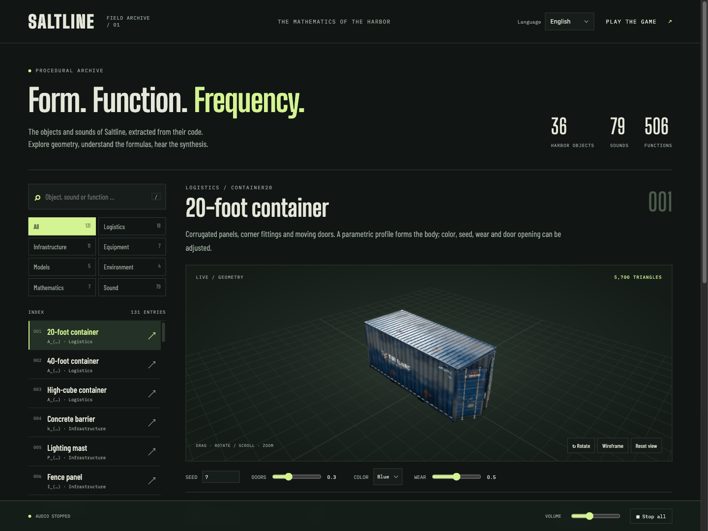
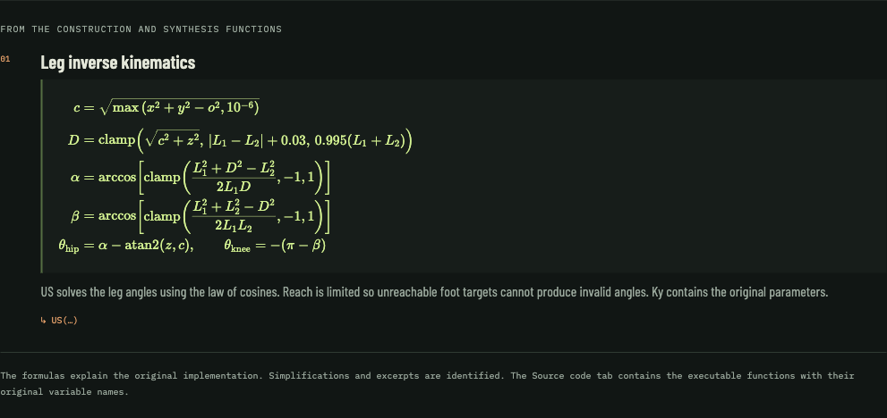

# Saltline Field Archive

[English](README.md) · **Deutsch** · [简体中文](README.zh-CN.md)

## Ein 3D-Hafenspiel in nur 3,55 MB

Das Bemerkenswerte an Saltline ist seine Größe: Das ursprünglich veröffentlichte Spiel passt in **eine einzige HTML-Datei mit 3,55 MB**. Darin stecken Three.js, Spiellogik, Hafenszene, Waffen, Roboter, Materialien und Klangsynthese. Der aktive JavaScript- und CSS-Spielkern belegt lediglich **1,65 MB**, einschließlich Three.js.

| Gemessener Bestandteil | Dateigröße |
| --- | --- |
| Veröffentlichtes Original: `original/index.html` | **3,55 MB** — 3.552.517 Bytes |
| Aktiver Spielkern: `game.js` + `ui.css` | **1,65 MB** — 1.652.301 Bytes |

Diese kompakte Größe entsteht dadurch, dass die Spielinhalte im Browser mathematisch erzeugt werden:

- **Prozedurale Geometrie:** Parameter, wiederholte Grundkörper, extrudierte Profile, Rotationsflächen und Splines konstruieren Container, Maschinen, Waffen und Roboter.
- **Prozedurale Materialien:** Shader, Rauschfunktionen und erzeugte Canvas-Texturen liefern Oberflächendetails, Lack, Rost, Verschleiß und Beschriftungen.
- **Prozedurales Audio:** Mathematische Wellenformen, Rauschen, Hüllkurven, Filter und geschichtete Synthese erzeugen Schüsse, Treffer, Maschinen, Wetter und Musik. Die Soundbank umfasst **79 Klänge mit 136 Varianten**.
- **Wiederverwendung und kompakte Bündelung:** Gemeinsame Geometrie- und Synthesefunktionen, Seed-gesteuerte Variation und ein minifizierter JavaScript-Bundle halten die gespeicherte Darstellung klein.

Meshes, Texturen und Audiopuffer entstehen zur Laufzeit; separate Modell-, Texturbild- oder aufgenommene Audiodateien werden für das Spiel nicht benötigt. Die Angaben verwenden dezimale MB (1 MB = 1.000.000 Bytes). Die Original-HTML-Datei enthält zusätzlich eine eingebettete frühere Spielversion. Lokale Fontdateien, dieser ergänzende Katalog, Dokumentation und Screenshots kommen zu den gemessenen Größen hinzu.

Ein lokaler, offline nutzbarer Browserkatalog für die **prozeduralen 3D-Objekte, mathematischen Funktionen und synthetisierten Klänge von Saltline**. Enthalten sind das ursprüngliche spielbare Hafenspiel, ein interaktiver Viewer, gesetzte Formeln, lesbare Quellfunktionen und Klangvorschauen mit WAV-Export.

Grundlage ist das öffentliche Saltline-Claude-Artefakt. Dessen eingebetteter Autorenhinweis nennt **Claude Fable 5.2** als Urheber der ersten Spielversion. Dieses Repository ergänzt den lokalen Betrieb und den mehrsprachigen Katalog. Siehe [Herkunft und Quellen](#herkunft-und-quellen).



## Funktionen

- **131 Katalogeinträge:** 36 registrierte Hafenobjekte sowie Waffen, Roboter, ein Handmodell, Hafenmodelle, mathematische Beispiele und die Soundbank.
- **Interaktive 3D-Vorschauen:** drehen, zoomen, Drahtgitter anzeigen, Objekt-Seeds ändern, Containertüren öffnen und Relaiszustände umschalten.
- **17 mathematische Erklärungen** mit Brüchen, Wurzeln, Summen und Fallunterscheidungen, gesetzt als HTML mit semantischem MathML.
- **506 extrahierte Anwendungsfunktionen** mit ursprünglichen Variablennamen, Zeilennummern und Bytepositionen in `game.js`.
- **79 Klänge mit 136 Varianten**, erzeugt durch die Originalgeneratoren. Einzelklänge und Loops anhören, Lautstärke regeln und PCM-WAV-Dateien herunterladen.
- **Englisch als Standard**, dazu Deutsch und vereinfachtes Chinesisch. Übersetzte Objektnamen, Beschreibungen, Formelerklärungen, Soundnamen und Bedienelemente; die Sprachwahl wird lokal gespeichert.
- **Lokale Ressourcen:** Three.js, prozedurale Materialien, Fonts und Formelsatz sind enthalten. Im Betrieb sind keine CDN-Zugriffe oder externen Modell-/Audiodownloads nötig.



## Schnellstart

Benötigt werden [Bun](https://bun.sh/) und ein moderner Browser mit WebGL 2 und Web Audio. Geprüft mit Bun **1.4.4**.

```sh
git clone https://github.com/TholeG/saltline-field-archive.git
cd saltline-field-archive
bun run start
```

Danach öffnen:

- **Katalog:** [http://127.0.0.1:3000/catalog.html](http://127.0.0.1:3000/catalog.html)
- **Spiel:** [http://127.0.0.1:3000/](http://127.0.0.1:3000/) — **Deploy** wählen. Das Spielmenü verlinkt ebenfalls auf den Katalog.

Die versionierten Ressourcen sind einsatzbereit: **Für Spiel und Katalog ist keine Paketinstallation nötig.** Audio startet nach einem Klick. Der Server bindet an `127.0.0.1`; beenden mit `Ctrl+C`. Für einen anderen Port:

```sh
PORT=3001 bun run start
```

## Sprachen

Im Kopfbereich **English**, **Deutsch** oder **简体中文** wählen. Ohne gespeicherte Auswahl startet der Katalog unabhängig von der Browsersprache auf Englisch. Ein URL-Parameter `lang` hat Vorrang vor der gespeicherten Auswahl:

- [English](http://127.0.0.1:3000/catalog.html?lang=en)
- [Deutsch](http://127.0.0.1:3000/catalog.html?lang=de)
- [简体中文](http://127.0.0.1:3000/catalog.html?lang=zh)

Der Katalog und sein Link im Spielmenü sind lokalisiert. Beim Sprachwechsel bleiben Eintrag, Parameter, Quellfunktion, Klangvariante und aktiver Tab erhalten; laufende Hörproben stoppen. Mathematische Symbole und Codekennungen behalten in allen Sprachen ihre Bedeutung.

## Bedienung

| Katalog | Aktion |
| --- | --- |
| Vorschau ziehen oder wischen | Objekt drehen |
| Mausrad | Zoomen |
| 3D-Canvas fokussieren, dann Pfeiltasten / `+` / `−` / `Home` | Drehen / zoomen / zurücksetzen |
| `/` | Suche fokussieren |
| Dropdown: Pfeiltasten, `Home` / `End` oder Namenseingabe | Optionen durchgehen |
| Dropdown: `Enter` / `Escape` | Übernehmen / abbrechen |

Die Dropdowns verwenden den Katalogstil und bleiben im Browserfenster. Bei Platzmangel öffnen sie oberhalb des Felds.

**Spiel:** WASD bewegen, Maus umsehen, linke Maustaste schießen, rechte Maustaste zielen, `R` nachladen, `Q` Waffe wechseln, `E` zum Trennen eines Relais halten, Leertaste springen, Shift sprinten, `C` ducken und Escape pausieren.

## Entwicklung und Prüfung

Entwicklungsabhängigkeiten werden zum erneuten Erzeugen der Formelressourcen benötigt:

```sh
bun install --frozen-lockfile
bun run dev
```

Nach Änderungen am ursprünglichen Spiel-Bundle die Katalog-Engine erneut extrahieren:

```sh
bun run catalog:extract
```

Nach Änderungen an Formeln in `catalog/latex.js` oder deren Zuordnung in `catalog/data.js`:

```sh
bun run catalog:math
```

KaTeX **0.19.1** wird beim Erzeugen der Ressourcen ausgeführt. HTML/MathML, Styles und Fonts sind versioniert; der Browser lädt zur Laufzeit kein KaTeX-JavaScript.

```sh
bun run catalog:check
```

Die Prüfung kontrolliert Übersetzungen aller drei Sprachen, unveränderte Objekt-/Klangzuordnungen, Quellfundstellen und gesetztes MathML. Außerdem werden **alle 136 Klangvarianten** synthetisiert und Sample für Sample mit dem Original verglichen. Dabei werden endliche Werte und nicht stumme Puffer geprüft.

Zusätzliche Browserprüfungen umfassten alle 131 Einträge je Sprache, blockierte externe Zugriffe, mobile Darstellung, Dropdown-Positionierung, Tastatur-/Touch-Bedienung, gespeicherte Sprachwahl, Audiowiedergabe und WAV-Export. Beim Spiel sind Start und Rendering geprüft; ein vollständiger Spieldurchlauf wurde nicht durchgeführt.

## Projektstruktur

| Pfad | Zweck |
| --- | --- |
| `catalog.html`, `catalog/app.js`, `catalog/styles.css` | Katalogseite, Viewer, Audiosteuerung und Layout |
| `catalog/data.js`, `catalog/latex.js` | Einträge und mathematische Formeln |
| `catalog/i18n.js`, `catalog/content-i18n.js` | Oberfläche und Inhalte auf Englisch, Deutsch und Chinesisch |
| `catalog/select.js` | Dropdown-Menüs innerhalb der Seite |
| `catalog/engine.js`, `catalog/math.js` | Generierte Engine-Exporte und gesetzte Formeln |
| `catalog/manifest.json` | SHA-256 der Quelle und Fundstellen der Originalfunktionen |
| `scripts/` | Extraktion, Formelerzeugung und Prüfung |
| `index.html`, `game.js`, `ui.css` | Lokale Spielseite, ursprünglicher JavaScript-Bundle und Spielstyles |
| `assets/`, `licenses/` | Lokale Fonts, KaTeX-Ressourcen und Komponentenlizenzen |
| `original/`, `source.json` | Originalartefakt, öffentliche Metadaten und Downloadherkunft |

## Herkunft und Quellen

Das importierte Spiel stammt aus dem öffentlichen [Saltline-Claude-Artefakt](https://claude.ai/artifact/BGY1SztrAYcJQHSsnHHGmp), veröffentlichte Version `1794338661-8a5e`. Der Autorenhinweis nennt Felix, schreibt die erste Version **Claude Fable 5.2** zu und beschreibt anschließende, vom Autor angeleitete Verbesserungen an Waffen, Sound und Spielmechanik.

`game.js` und die heruntergeladenen Dateien in `original/` bleiben erhalten. Die generierte Katalog-Engine ersetzt den Spielstart durch Exporte vorhandener Konstruktoren und Klanggeneratoren. Der Katalog erklärt die ursprüngliche Mathematik; vereinfachte Formeln und Auszüge sind gekennzeichnet. Einzelklangvorschauen verwenden die Originalgeneratoren ohne den vollständigen räumlichen Audiomix des Spiels.

Die heruntergeladene Original-HTML-Datei hat folgenden SHA-256:

```text
b346ad3a5f4ee697a95439c3f9ba1a4d4b600719e3918e72147883541b7c0883
```

Ressourcen-URLs und Prüfsummen stehen in [source.json](source.json). Die [Drittanbieterhinweise](THIRD_PARTY_NOTICES.md) enthalten Herkunft und Komponentenlizenzen, unter anderem für Three.js, KaTeX und die Fonts.

**Suchbegriffe:** Saltline · Anthropic · Claude · Fable 5.2 · Three.js · WebGL · Web Audio · prozedurale Generierung · prozedurales Audio · digitale Signalverarbeitung · mathematische Visualisierung · MathML · KaTeX · 3D-Viewer · Browserspiel · Bun · mehrsprachig · offline-first.
