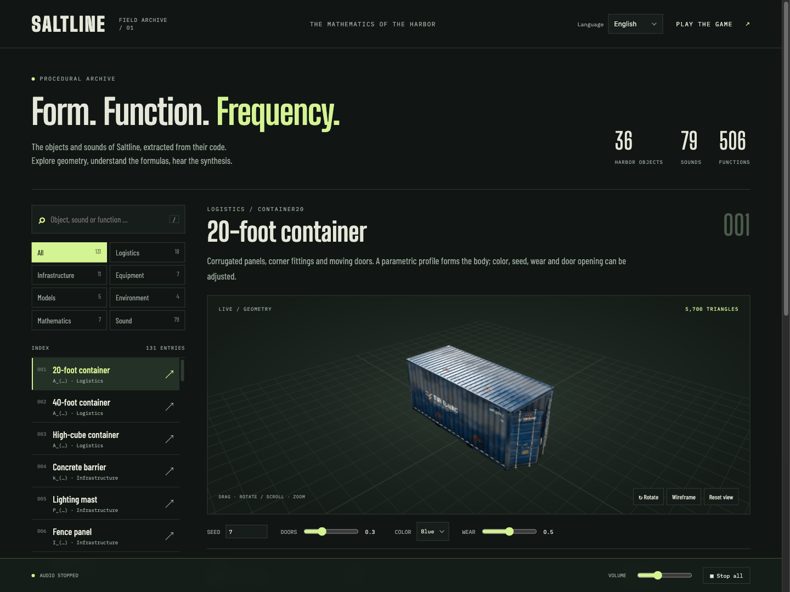
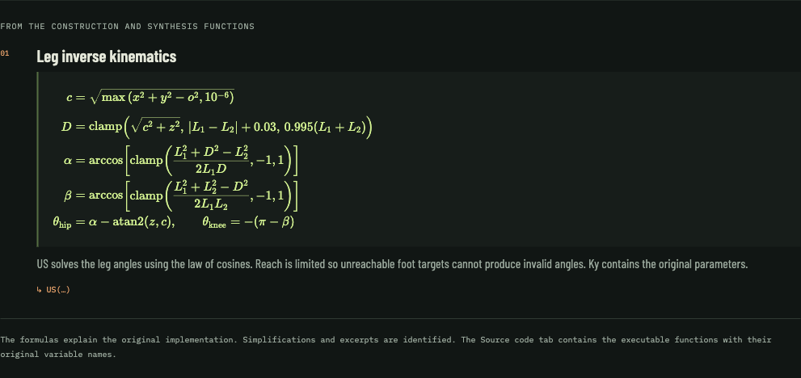

# Saltline Field Archive

**English** · [Deutsch](README.de.md) · [简体中文](README.zh-CN.md)

## A 3D harbor game in just 3.55 MB

The remarkable part of Saltline is its size: the original published game fits in a **single 3.55 MB HTML file**, including Three.js, game logic, the harbor scene, weapons, robots, materials, and sound synthesis. Its active JavaScript and CSS core occupies just **1.65 MB**, with Three.js already included.

| Measured component | File size |
| --- | --- |
| Published original: `original/index.html` | **3.55 MB** — 3,552,517 bytes |
| Active game core: `game.js` + `ui.css` | **1.65 MB** — 1,652,301 bytes |

This compact size comes from generating the game's content mathematically in the browser:

- **Procedural geometry:** parameters, repeated primitives, extruded profiles, surfaces of revolution, and splines construct containers, machinery, weapons, and robots.
- **Procedural materials:** shaders, noise functions, and generated canvas textures create surface detail, paint, rust, wear, and labels.
- **Procedural audio:** mathematical waveforms, noise, envelopes, filters, and layered synthesis generate shots, impacts, machinery, weather, and music. The sound bank contains **79 sounds with 136 variants**.
- **Code reuse and compact bundling:** shared geometry and synthesis functions, seeded variation, and a minified JavaScript bundle keep the stored representation small.

The browser creates meshes, textures, and audio buffers at runtime, so the game does not need separate model, texture-image, or recorded-audio assets. Sizes above use decimal MB (1 MB = 1,000,000 bytes). The original HTML also retains an embedded earlier game version; local font files, this additional catalog, documentation, and screenshots are separate from these measurements.

Explore the **procedural 3D objects, mathematics, and synthesized audio of Saltline** in a local, offline-ready browser catalog. Includes the original playable harbor game, an interactive viewer, typeset equations, readable source functions, and sound previews with WAV export.

Based on the public Saltline Claude artifact, whose embedded author note credits **Claude Fable 5.2** for the initial game. This repository adds the local packaging and multilingual field archive. See [origin and attribution](#origin-and-attribution).



## Features

- **131 catalog entries**, covering 36 registered harbor objects, weapons, robots, a hand rig, harbor scenery, mathematical examples, and the sound bank.
- **Interactive 3D previews:** rotate, zoom, inspect wireframes, change object seeds, open container doors, and switch relay states.
- **17 mathematical explanations**, with fractions, roots, sums, and piecewise functions rendered as HTML with semantic MathML.
- **506 extracted application functions**, shown with their original variable names, line numbers, and byte offsets in `game.js`.
- **79 sounds and 136 variants**, synthesized by the original generators. Preview individual sounds and loops, adjust volume, and download PCM WAV files.
- **English by default**, plus German and simplified Chinese. Localized object names, descriptions, equations' explanations, sound labels, and controls; language selection is saved locally.
- **Local resources:** bundled Three.js, procedural materials, fonts, and formula markup. No CDN or external model/audio downloads during use.



## Quick start

Requires [Bun](https://bun.sh/) and a modern browser with WebGL 2 and Web Audio. Tested with Bun **1.4.4**.

```sh
git clone https://github.com/TholeG/saltline-field-archive.git
cd saltline-field-archive
bun run start
```

Open:

- **Catalog:** [http://127.0.0.1:3000/catalog.html](http://127.0.0.1:3000/catalog.html)
- **Game:** [http://127.0.0.1:3000/](http://127.0.0.1:3000/) — choose **Deploy**. The game menu also links to the catalog.

The checked-in assets are ready to use: **no package installation is needed to run the game or catalog**. Audio starts after a click. The server binds to `127.0.0.1`; stop it with `Ctrl+C`. For another port:

```sh
PORT=3001 bun run start
```

## Languages

Choose **English**, **Deutsch**, or **简体中文** in the header. Without a saved choice, the catalog starts in English regardless of browser language. A `lang` URL parameter overrides the saved preference:

- [English](http://127.0.0.1:3000/catalog.html?lang=en)
- [Deutsch](http://127.0.0.1:3000/catalog.html?lang=de)
- [简体中文](http://127.0.0.1:3000/catalog.html?lang=zh)

The catalog and its game-menu link are localized. Switching languages preserves the selected entry, parameters, source function, sound variant, and active tab; it stops any playing preview. Mathematical symbols and source identifiers keep the same meaning across languages.

## Controls

| Catalog | Action |
| --- | --- |
| Drag or swipe the preview | Rotate the object |
| Mouse wheel | Zoom |
| Focus the 3D canvas, then arrow keys / `+` / `−` / `Home` | Rotate / zoom / reset |
| `/` | Focus search |
| Dropdown: arrow keys, `Home` / `End`, or type a name | Navigate options |
| Dropdown: `Enter` / `Escape` | Select / cancel |

Dropdown menus use the catalog's styling and stay inside the browser viewport, opening above the field when needed.

**Game:** WASD to move, mouse to look, left click to fire, right click to aim, `R` to reload, `Q` to switch weapons, hold `E` to disconnect a relay, Space to jump, Shift to sprint, `C` to crouch, and Escape to pause.

## Development and checks

Development dependencies are only needed to regenerate the formula assets:

```sh
bun install --frozen-lockfile
bun run dev
```

After changes to the original game bundle, regenerate the exported catalog engine:

```sh
bun run catalog:extract
```

After changing equations in `catalog/latex.js` or their assignments in `catalog/data.js`:

```sh
bun run catalog:math
```

KaTeX **0.19.1** runs during generation. The generated HTML/MathML, styles, and fonts are checked in; the browser does not load KaTeX JavaScript at runtime.

```sh
bun run catalog:check
```

This checks translation coverage in all three languages, stable object/sound assignments, source offsets, and rendered MathML. It also synthesizes **all 136 sound variants** and compares every sample with the original code, checking finite values and non-silent buffers.

Browser checks have additionally covered all 131 entries in each language, blocked external requests, mobile layouts, dropdown positioning, keyboard/touch interaction, saved language selection, audio playback, and WAV export. Game checks cover startup and rendering; no complete playthrough has been performed.

## Project layout

| Path | Purpose |
| --- | --- |
| `catalog.html`, `catalog/app.js`, `catalog/styles.css` | Catalog page, viewer, audio controls, and layout |
| `catalog/data.js`, `catalog/latex.js` | Entry definitions and mathematical equations |
| `catalog/i18n.js`, `catalog/content-i18n.js` | English, German, and Chinese interface/content |
| `catalog/select.js` | In-page dropdown menus |
| `catalog/engine.js`, `catalog/math.js` | Generated engine exports and typeset formula markup |
| `catalog/manifest.json` | Source SHA-256 and original function locations |
| `scripts/` | Extraction, formula generation, and verification |
| `index.html`, `game.js`, `ui.css` | Local game page, original JavaScript bundle, and game styles |
| `assets/`, `licenses/` | Local fonts, KaTeX assets, and component licenses |
| `original/`, `source.json` | Original artifact, public metadata, and download provenance |

## Origin and attribution

The imported game comes from the public [Saltline Claude artifact](https://claude.ai/artifact/BGY1SztrAYcJQHSsnHHGmp), published version `1794338661-8a5e`. Its author note names Felix, credits **Claude Fable 5.2** for the initial build, and describes subsequent author-led improvements to weapons, sound, and gameplay.

`game.js` and the downloaded files in `original/` are preserved. The generated catalog engine replaces game startup with exports of existing constructors and sound generators. The catalog explains the original mathematics; simplified formulas and excerpts are identified. Individual sound previews use the original sample generators without the game's full spatial audio mix.

The downloaded original HTML has SHA-256:

```text
b346ad3a5f4ee697a95439c3f9ba1a4d4b600719e3918e72147883541b7c0883
```

See [source.json](source.json) for resource URLs and checksums, and [third-party notices](THIRD_PARTY_NOTICES.md) for attribution and component license texts, including Three.js, KaTeX, and the fonts.

**Discovery terms:** Saltline · Anthropic · Claude · Fable 5.2 · Three.js · WebGL · Web Audio · procedural generation · procedural audio · digital signal processing · mathematical visualization · MathML · KaTeX · 3D viewer · browser game · Bun · multilingual · offline-first.
