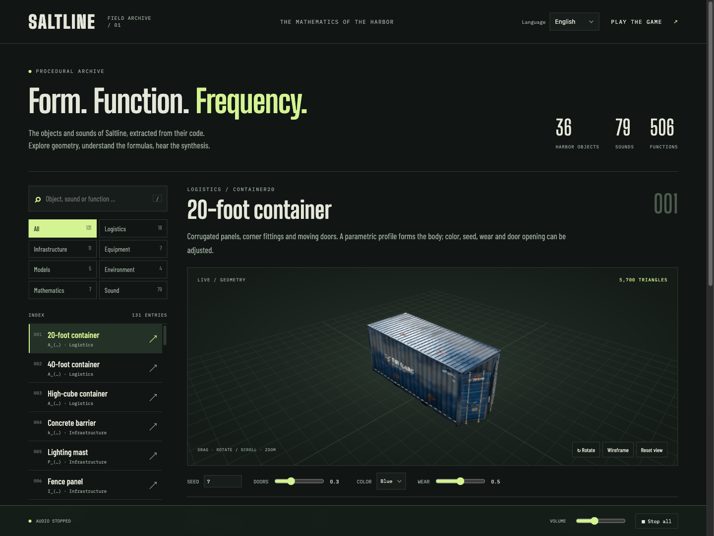
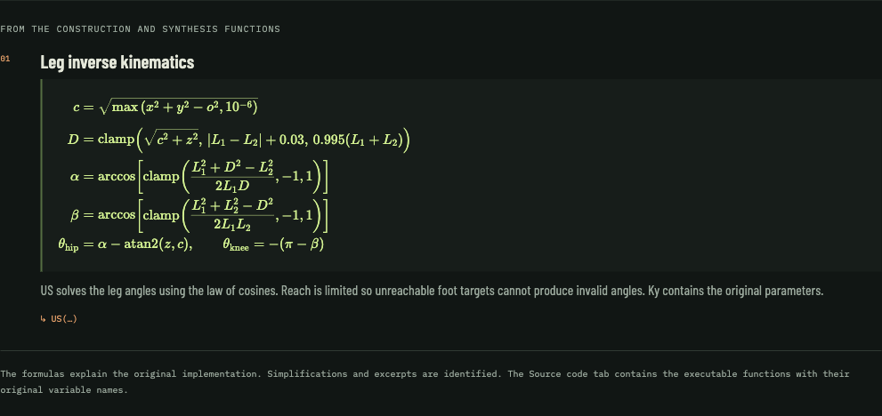

# Saltline Field Archive

[English](README.md) · [Deutsch](README.de.md) · **简体中文**

在本地浏览器图鉴中探索 **Saltline 的程序化三维物体、数学原理与合成音效**，下载后可离线使用。项目包含原始可玩的港口游戏、交互式三维查看器、排版公式、可读源函数，以及支持 WAV 导出的声音预览。

项目基于公开发布的 Saltline Claude 工件。游戏内嵌的作者说明将初版游戏归功于 **Claude Fable 5.2**。本仓库增加了本地运行支持和多语言图鉴。详见[来源与致谢](#来源与致谢)。



## 功能

- **131 个图鉴条目**：涵盖 36 种已注册港口物体，以及武器、机器人、手部骨架、港口场景、数学示例和声音库。
- **交互式三维预览**：旋转、缩放、查看线框、修改随机种子、打开集装箱门，以及切换中继站状态。
- **17 项数学原理说明**：分数、根式、求和与分段函数以 HTML 排版，并包含语义化 MathML。
- **506 个提取的应用函数**：保留原始变量名，并标注其在 `game.js` 中的行号与字节偏移。
- **79 种声音，共 136 个变体**：由原始生成器合成。可试听单次音效与循环音效、调整音量，并下载 PCM WAV 文件。
- **默认英语**，另提供德语和简体中文。物体名称、描述、公式说明、声音标签与操作界面均已本地化；语言选择保存在本地。
- **本地资源**：内置 Three.js、程序化材质、字体和公式标记。使用时无需访问 CDN，也无需下载外部模型或音频。



## 快速开始

需要安装 [Bun](https://bun.sh/)，并使用支持 WebGL 2 和 Web Audio 的现代浏览器。已使用 Bun **1.4.4** 验证。

```sh
git clone https://github.com/TholeG/saltline-field-archive.git
cd saltline-field-archive
bun run start
```

然后打开：

- **图鉴：** [http://127.0.0.1:3000/catalog.html](http://127.0.0.1:3000/catalog.html)
- **游戏：** [http://127.0.0.1:3000/](http://127.0.0.1:3000/) — 选择 **Deploy**。游戏菜单也提供图鉴入口。

仓库已包含可直接使用的资源：**运行游戏或图鉴无需安装依赖包。** 点击后即可开始播放音频。服务器仅监听 `127.0.0.1`，按 `Ctrl+C` 停止。使用其他端口：

```sh
PORT=3001 bun run start
```

## 语言

在页眉选择 **English**、**Deutsch** 或 **简体中文**。未保存语言选择时，图鉴默认使用英语，不受浏览器语言影响。URL 中的 `lang` 参数优先于已保存的选择：

- [English](http://127.0.0.1:3000/catalog.html?lang=en)
- [Deutsch](http://127.0.0.1:3000/catalog.html?lang=de)
- [简体中文](http://127.0.0.1:3000/catalog.html?lang=zh)

图鉴及游戏菜单中的图鉴入口均已本地化。切换语言时会保留当前条目、参数、源函数、声音变体和选项卡，并停止正在播放的试听。数学符号和源代码标识符在所有语言中保持相同含义。

## 操作

| 图鉴操作 | 功能 |
| --- | --- |
| 拖动或滑动预览 | 旋转物体 |
| 鼠标滚轮 | 缩放 |
| 聚焦三维画布，然后使用方向键 / `+` / `−` / `Home` | 旋转 / 缩放 / 重置 |
| `/` | 聚焦搜索框 |
| 下拉菜单：方向键、`Home` / `End` 或输入名称 | 浏览选项 |
| 下拉菜单：`Enter` / `Escape` | 确认 / 取消 |

下拉菜单采用图鉴样式，始终位于浏览器可视区域内；下方空间不足时，会在控件上方打开。

**游戏操作：** WASD 移动，鼠标观察，左键射击，右键瞄准，`R` 换弹，`Q` 切换武器，按住 `E` 断开中继站，空格跳跃，Shift 冲刺，`C` 蹲下，Escape 暂停。

## 开发与验证

重新生成公式资源时需要开发依赖：

```sh
bun install --frozen-lockfile
bun run dev
```

修改原始游戏包后，重新生成图鉴引擎导出：

```sh
bun run catalog:extract
```

修改 `catalog/latex.js` 中的公式，或调整 `catalog/data.js` 中的公式关联后：

```sh
bun run catalog:math
```

KaTeX **0.19.1** 仅在资源生成阶段运行。生成的 HTML/MathML、样式和字体均已纳入仓库，浏览器运行时无需加载 KaTeX JavaScript。

```sh
bun run catalog:check
```

此检查验证三种语言的翻译覆盖率、物体与声音关联的一致性、源代码偏移和公式 MathML。它还会合成**全部 136 个声音变体**，将每个采样值与原始代码逐一比较，并检查数值有效性及缓冲区非静音。

额外的浏览器检查覆盖了每种语言下的全部 131 个条目、阻断外部请求的运行方式、移动端布局、下拉菜单定位、键盘与触控交互、语言选择保存、音频播放和 WAV 导出。游戏部分已验证启动与渲染，尚未进行完整通关测试。

## 项目结构

| 路径 | 用途 |
| --- | --- |
| `catalog.html`、`catalog/app.js`、`catalog/styles.css` | 图鉴页面、查看器、音频控制与布局 |
| `catalog/data.js`、`catalog/latex.js` | 条目定义与数学公式 |
| `catalog/i18n.js`、`catalog/content-i18n.js` | 英语、德语与中文界面和内容 |
| `catalog/select.js` | 页面内下拉菜单 |
| `catalog/engine.js`、`catalog/math.js` | 生成的引擎导出与公式标记 |
| `catalog/manifest.json` | 源文件 SHA-256 与原始函数位置 |
| `scripts/` | 提取、公式生成与验证脚本 |
| `index.html`、`game.js`、`ui.css` | 本地游戏页面、原始 JavaScript 包与游戏样式 |
| `assets/`、`licenses/` | 本地字体、KaTeX 资源与组件许可证 |
| `original/`、`source.json` | 原始工件、公开元数据与下载来源 |

## 来源与致谢

导入的游戏来自公开的 [Saltline Claude 工件](https://claude.ai/artifact/BGY1SztrAYcJQHSsnHHGmp)，发布版本为 `1794338661-8a5e`。作者说明提到 Felix，将初版归功于 **Claude Fable 5.2**，并描述了随后由作者推动的武器、音效与玩法改进。

`game.js` 以及 `original/` 中下载的文件均予以保留。生成的图鉴引擎将游戏启动替换为现有构造函数与声音生成器的导出。图鉴解释原始数学实现，并注明简化公式与节选。单独的声音试听使用原始采样生成器，不含游戏中完整的空间音频混音。

下载的原始 HTML 文件具有以下 SHA-256：

```text
b346ad3a5f4ee697a95439c3f9ba1a4d4b600719e3918e72147883541b7c0883
```

资源 URL 与校验值见 [source.json](source.json)。[第三方声明](THIRD_PARTY_NOTICES.md)记录了来源和组件许可证，包括 Three.js、KaTeX 与字体。

**检索关键词：** Saltline · Anthropic · Claude · Fable 5.2 · Three.js · WebGL · Web Audio · 程序化生成 · 程序化音频 · 数字信号处理 · 数学可视化 · MathML · KaTeX · 三维查看器 · 浏览器游戏 · Bun · 多语言 · 离线优先。
